<pre>
<picture><source media="(prefers-color-scheme: dark)" srcset="assets/fbbf8ba4c4a7.svg"></picture>
<picture><source media="(prefers-color-scheme: dark)" srcset="assets/12761894ad33.svg"></picture>
<picture><source media="(prefers-color-scheme: dark)" srcset="assets/fcd8cb416e77.svg"></picture>
<picture><source media="(prefers-color-scheme: dark)" srcset="assets/9dbf0f7350f5.svg"></picture>

<picture><source media="(prefers-color-scheme: dark)" srcset="assets/fc76df8a42ad.svg"></picture>
<picture><source media="(prefers-color-scheme: dark)" srcset="assets/172a0ed819d1.svg"></picture>
<picture><source media="(prefers-color-scheme: dark)" srcset="assets/66f3abe42c13.svg"></picture>

<picture><source media="(prefers-color-scheme: dark)" srcset="assets/d06d3ffd1bfe.svg"></picture>
<picture><source media="(prefers-color-scheme: dark)" srcset="assets/c97c5ff1163e.svg"></picture>
<picture><source media="(prefers-color-scheme: dark)" srcset="assets/9238a118f463.svg"></picture>

<picture><source media="(prefers-color-scheme: dark)" srcset="assets/5fa7a2fc5aed.svg"></picture>
<a href="https://bengous.github.io/petit-manege-classe/"><picture><source media="(prefers-color-scheme: dark)" srcset="assets/075b79832c6f.svg"></picture></a>
<a href="https://github.com/bengous/claude-code-plugins"><picture><source media="(prefers-color-scheme: dark)" srcset="assets/e07b2941023e.svg"></picture></a>
<a href="https://github.com/bengous/explorador-genealogia-bengolea"><picture><source media="(prefers-color-scheme: dark)" srcset="assets/5b6109ad9d45.svg"></picture></a>
<a href="https://github.com/bengous/scripts-and-snippets"><picture><source media="(prefers-color-scheme: dark)" srcset="assets/495842882bf3.svg"></picture></a>
<a href="https://bengous.github.io/git-image-par-image/"><picture><source media="(prefers-color-scheme: dark)" srcset="assets/606d0f434f3a.svg"></picture></a>
<a href="https://bengous.github.io/d2-lab/"><picture><source media="(prefers-color-scheme: dark)" srcset="assets/58f1b83de03d.svg"></picture></a>
<a href="https://github.com/bengous/adv360"><picture><source media="(prefers-color-scheme: dark)" srcset="assets/ef75bfb7e003.svg"></picture></a>
<a href="https://github.com/bengous/agentcraft"><picture><source media="(prefers-color-scheme: dark)" srcset="assets/2b44fe2451cc.svg"></picture></a>
<a href="https://github.com/bengous/circuito-combinacion"><picture><source media="(prefers-color-scheme: dark)" srcset="assets/4d74ebad8a22.svg"></picture></a>
<a href="https://github.com/bengous/caveats"><picture><source media="(prefers-color-scheme: dark)" srcset="assets/a017411231f6.svg"></picture></a>
<a href="https://github.com/bengous/agents-skills"><picture><source media="(prefers-color-scheme: dark)" srcset="assets/53b239e6e0fa.svg"></picture></a>

<picture><source media="(prefers-color-scheme: dark)" srcset="assets/c0cc0317524b.svg"></picture>
<a href="https://github.com/bengous/claude-code-plugins"><picture><source media="(prefers-color-scheme: dark)" srcset="assets/0ec833363021.svg"></picture></a>
<a href="https://github.com/bengous/vex"><picture><source media="(prefers-color-scheme: dark)" srcset="assets/0cac6209e47a.svg"></picture></a>
<a href="https://github.com/bengous/agents-skills"><picture><source media="(prefers-color-scheme: dark)" srcset="assets/737d920dc334.svg"></picture></a>
<a href="https://github.com/bengous/wireframer"><picture><source media="(prefers-color-scheme: dark)" srcset="assets/105de23351b6.svg"></picture></a>
<a href="https://github.com/bengous/hex-validator"><picture><source media="(prefers-color-scheme: dark)" srcset="assets/29b1106722ae.svg"></picture></a>
<a href="https://github.com/bengous/custom-scripts"><picture><source media="(prefers-color-scheme: dark)" srcset="assets/b1436fe207e0.svg"></picture></a>
<a href="https://github.com/bengous/adv360"><picture><source media="(prefers-color-scheme: dark)" srcset="assets/efbcc57fa59d.svg"></picture></a>
<a href="https://github.com/bengous/scripts-and-snippets"><picture><source media="(prefers-color-scheme: dark)" srcset="assets/cbdbeb969616.svg"></picture></a>
<a href="https://github.com/bengous/agent-notifier-omarchy"><picture><source media="(prefers-color-scheme: dark)" srcset="assets/7d36d4168f58.svg"></picture></a>
<a href="https://github.com/bengous/caveats"><picture><source media="(prefers-color-scheme: dark)" srcset="assets/459a577f4cc9.svg"></picture></a>
<a href="https://github.com/bengous/kitsmith"><picture><source media="(prefers-color-scheme: dark)" srcset="assets/a455e8d71316.svg"></picture></a>
<a href="https://github.com/bengous/codex-path-rules"><picture><source media="(prefers-color-scheme: dark)" srcset="assets/beb93dcf3499.svg"></picture></a>
<a href="https://github.com/bengous/npm-supply-exposure"><picture><source media="(prefers-color-scheme: dark)" srcset="assets/f80465ee3fd5.svg"></picture></a>
<a href="https://github.com/bengous/runweaver"><picture><source media="(prefers-color-scheme: dark)" srcset="assets/73ad6f929d64.svg"></picture></a>
<a href="https://github.com/bengous/ccgateways"><picture><source media="(prefers-color-scheme: dark)" srcset="assets/afe2a899b1e9.svg"></picture></a>
<a href="https://github.com/bengous/multireports-end2end-helper"><picture><source media="(prefers-color-scheme: dark)" srcset="assets/a8807aa6c486.svg"></picture></a>
<a href="https://github.com/bengous/agent-visitor"><picture><source media="(prefers-color-scheme: dark)" srcset="assets/3f5ecb4c6f5c.svg"></picture></a>
<a href="https://github.com/bengous/prompt-context-router"><picture><source media="(prefers-color-scheme: dark)" srcset="assets/2cedc6f2d79b.svg"></picture></a>
<a href="https://github.com/bengous/claude-to-codex-session"><picture><source media="(prefers-color-scheme: dark)" srcset="assets/a784e6b8b12f.svg"></picture></a>
<a href="https://github.com/bengous/productivity-tracking"><picture><source media="(prefers-color-scheme: dark)" srcset="assets/eadb739c8544.svg"></picture></a>
<a href="https://github.com/bengous/whisperer"><picture><source media="(prefers-color-scheme: dark)" srcset="assets/5110cbcd303f.svg"></picture></a>
<a href="https://github.com/bengous/agentlink"><picture><source media="(prefers-color-scheme: dark)" srcset="assets/bc9f08a5b0b9.svg"></picture></a>
<a href="https://github.com/bengous/bookmarker"><picture><source media="(prefers-color-scheme: dark)" srcset="assets/942dfa5de909.svg"></picture></a>
<a href="https://github.com/bengous/draft-flow-refine"><picture><source media="(prefers-color-scheme: dark)" srcset="assets/8a148ca6579f.svg"></picture></a>
<a href="https://github.com/bengous/claude-hooks"><picture><source media="(prefers-color-scheme: dark)" srcset="assets/e12123645bf0.svg"></picture></a>
<a href="https://github.com/bengous/hookjson"><picture><source media="(prefers-color-scheme: dark)" srcset="assets/ae1b6b48119f.svg"></picture></a>

<picture><source media="(prefers-color-scheme: dark)" srcset="assets/8acf702de12e.svg"></picture>
<a href="https://github.com/bengous/ai-context-layers"><picture><source media="(prefers-color-scheme: dark)" srcset="assets/7b0b22fc6ed8.svg"></picture></a>
<a href="https://github.com/bengous/docaudit"><picture><source media="(prefers-color-scheme: dark)" srcset="assets/f6a1c4cf3372.svg"></picture></a>
<a href="https://bengous.github.io/cap/"><picture><source media="(prefers-color-scheme: dark)" srcset="assets/7a9ef5f2240f.svg"></picture></a>
<a href="https://github.com/bengous/explorador-genealogia-bengolea"><picture><source media="(prefers-color-scheme: dark)" srcset="assets/bf2b7f56e295.svg"></picture></a>
<a href="https://bengous.github.io/d2-lab/"><picture><source media="(prefers-color-scheme: dark)" srcset="assets/8c4f6d0eebc3.svg"></picture></a>
<a href="https://github.com/bengous/circuito-combinacion"><picture><source media="(prefers-color-scheme: dark)" srcset="assets/895f98e58591.svg"></picture></a>
<a href="https://bengous.github.io/git-image-par-image/"><picture><source media="(prefers-color-scheme: dark)" srcset="assets/2f198ee0daa6.svg"></picture></a>
<a href="https://github.com/bengous/agentcraft"><picture><source media="(prefers-color-scheme: dark)" srcset="assets/f0aaa0030a54.svg"></picture></a>
<a href="https://github.com/bengous/d2r-manager"><picture><source media="(prefers-color-scheme: dark)" srcset="assets/70e8546e2797.svg"></picture></a>
<a href="https://github.com/bengous/ambiens"><picture><source media="(prefers-color-scheme: dark)" srcset="assets/cbb697bf7fd7.svg"></picture></a>
<a href="https://github.com/bengous/effect-visual-tutor"><picture><source media="(prefers-color-scheme: dark)" srcset="assets/18bdd2839ec5.svg"></picture></a>
<a href="https://bengous.github.io/pepin/"><picture><source media="(prefers-color-scheme: dark)" srcset="assets/b871d6523fda.svg"></picture></a>
<a href="https://github.com/bengous/potabilis"><picture><source media="(prefers-color-scheme: dark)" srcset="assets/fc88292087f1.svg"></picture></a>
<a href="https://github.com/bengous/go-htmx-todo"><picture><source media="(prefers-color-scheme: dark)" srcset="assets/a180361a1b11.svg"></picture></a>
<a href="https://github.com/bengous/pharmock"><picture><source media="(prefers-color-scheme: dark)" srcset="assets/1438d98e7434.svg"></picture></a>
<a href="https://github.com/bengous/rust-buildsaver"><picture><source media="(prefers-color-scheme: dark)" srcset="assets/ed1423569d21.svg"></picture></a>
<a href="https://github.com/bengous/nextjs-galerie-template"><picture><source media="(prefers-color-scheme: dark)" srcset="assets/9c2ee1d5fc1b.svg"></picture></a>
<a href="https://github.com/bengous/go-httpclient"><picture><source media="(prefers-color-scheme: dark)" srcset="assets/9d9f4a1bebcd.svg"></picture></a>
<a href="https://github.com/bengous/rust-game-of-conway"><picture><source media="(prefers-color-scheme: dark)" srcset="assets/35282cd6ceca.svg"></picture></a>
<a href="https://github.com/bengous/csv-merge-edu"><picture><source media="(prefers-color-scheme: dark)" srcset="assets/222328b3ff11.svg"></picture></a>

<picture><source media="(prefers-color-scheme: dark)" srcset="assets/9a7d56a30ee2.svg"></picture>
<a href="https://github.com/bengous/MindstormLeagueDecision"><picture><source media="(prefers-color-scheme: dark)" srcset="assets/ddbebe186b81.svg"></picture></a>
<a href="https://github.com/bengous/introdistributedsystems"><picture><source media="(prefers-color-scheme: dark)" srcset="assets/323f925b10ec.svg"></picture></a>
<a href="https://github.com/bengous/tli-downloader"><picture><source media="(prefers-color-scheme: dark)" srcset="assets/3199cd79cd9f.svg"></picture></a>
<a href="https://github.com/bengous/cosmopolitan"><picture><source media="(prefers-color-scheme: dark)" srcset="assets/3828ab471b2b.svg"></picture></a>
<a href="https://github.com/bengous/SocialBuddies"><picture><source media="(prefers-color-scheme: dark)" srcset="assets/64f9ae1a1269.svg"></picture></a>
<a href="https://github.com/bengous/mincaml-compiler"><picture><source media="(prefers-color-scheme: dark)" srcset="assets/f5a6239a6128.svg"></picture></a>
<a href="https://github.com/bengous/SabikeMockups"><picture><source media="(prefers-color-scheme: dark)" srcset="assets/87f9dcb6e0ff.svg"></picture></a>
<a href="https://github.com/bengous/Sabike"><picture><source media="(prefers-color-scheme: dark)" srcset="assets/2937a6a30ce1.svg"></picture></a>
<a href="https://github.com/bengous/SocialBuddiesMaven"><picture><source media="(prefers-color-scheme: dark)" srcset="assets/79a71f0313e9.svg"></picture></a>
<a href="https://github.com/bengous/IonicFirebaseToutdoux"><picture><source media="(prefers-color-scheme: dark)" srcset="assets/3e018c98b048.svg"></picture></a>
<a href="https://github.com/bengous/DevOpsPandasS"><picture><source media="(prefers-color-scheme: dark)" srcset="assets/f34688e520ed.svg"></picture></a>
<a href="https://github.com/bengous/Javaneeese"><picture><source media="(prefers-color-scheme: dark)" srcset="assets/70e552c91b95.svg"></picture></a>
<a href="https://github.com/bengous/IDS"><picture><source media="(prefers-color-scheme: dark)" srcset="assets/fe829c7ced61.svg"></picture></a>
<a href="https://github.com/bengous/patia"><picture><source media="(prefers-color-scheme: dark)" srcset="assets/e7517f46bfab.svg"></picture></a>
<a href="https://github.com/bengous/prime-courses"><picture><source media="(prefers-color-scheme: dark)" srcset="assets/66f3f13c5c16.svg"></picture></a>
<a href="https://github.com/bengous/AdventOfCode2023"><picture><source media="(prefers-color-scheme: dark)" srcset="assets/b20795dd97e5.svg"></picture></a>
<a href="https://github.com/bengous/AdventOfCode2022"><picture><source media="(prefers-color-scheme: dark)" srcset="assets/9b66761a5a4d.svg"></picture></a>

<picture><source media="(prefers-color-scheme: dark)" srcset="assets/f07d010ccef1.svg"></picture>
<a href="https://domocuisto.com"><picture><source media="(prefers-color-scheme: dark)" srcset="assets/11ef5a39766b.svg"></picture></a>
<a href="https://bengous.github.io/petit-manege-classe/"><picture><source media="(prefers-color-scheme: dark)" srcset="assets/9c85cafb6124.svg"></picture></a>
<a href="https://github.com/bengous/jukebox"><picture><source media="(prefers-color-scheme: dark)" srcset="assets/ab7339173413.svg"></picture></a>
<a href="https://guigpap.github.io/CV/"><picture><source media="(prefers-color-scheme: dark)" srcset="assets/5e669b1e6974.svg"></picture></a>
<a href="https://benjamin-rouanet.github.io/mon-cv/"><picture><source media="(prefers-color-scheme: dark)" srcset="assets/514b51d9f92d.svg"></picture></a>

<picture><source media="(prefers-color-scheme: dark)" srcset="assets/3d611904a421.svg"></picture>
<picture><source media="(prefers-color-scheme: dark)" srcset="assets/b7afc0c4751b.svg"></picture>
<picture><source media="(prefers-color-scheme: dark)" srcset="assets/f419bc3551a4.svg"></picture>

<picture><source media="(prefers-color-scheme: dark)" srcset="assets/3a2ada963e19.svg"></picture>
<a href="https://bengous.github.io/IdeAs/"><picture><source media="(prefers-color-scheme: dark)" srcset="assets/db5db60b800e.svg"></picture></a>
<a href="https://www.linkedin.com/in/augustinbengolea/"><picture><source media="(prefers-color-scheme: dark)" srcset="assets/33de64bd8607.svg"></picture></a>

<picture><source media="(prefers-color-scheme: dark)" srcset="assets/fee8924ba113.svg"></picture>
</pre>
